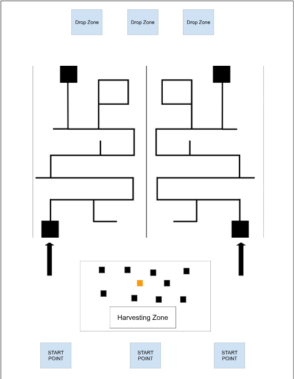
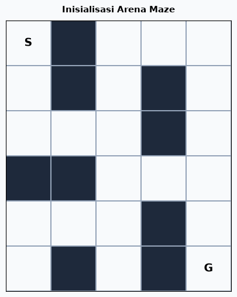

# 🤖 TEKNIS TUGAS BESAR MAGNESIS 2026

---

>Version : 1.0

## 💡 Kenapa Harus Pakai PlatformIO (PIO)?

Biar tim Programming dan Elektro tidak pusing saat kolaborasi:

* **Buat Anak Programming:**
  * **Anti Ribet Library:** Cukup tulis nama library di satu file konfigurasi (`platformio.ini`), semuanya langsung terunduh otomatis. Tidak ada drama *"di laptop saya bisa jalan, di laptop kamu error"*.
  * **Koding Lebih Cepat & Rapi:** Fitur pelengkap otomatis (autocomplete), pendeteksi typo kodingan langsung muncul tanpa harus nunggu proses kompilasi selesai.
  * **Struktur File Jelas:** File kodingan terpisah rapi per folder (`src/`, `include/`, `lib/`), cocok untuk modularisasi fungsi sensor dan navigasi.

* **Buat Anak Elektro & Hardware:**
  * **Ganti Board Super Gampang:** Mau tes kode di Arduino Uno lalu pindah ke ESP32 atau STM32? Cukup ganti satu baris teks pengaturan tanpa install driver/board manager manual dari awal.
  * **Serial Monitor Nyaman:** Monitor pembacaan sensor langsung nempel di dalam editor, tidak membuka jendela pop-up baru yang menumpuk di layar.

---

## 🛠️ Panduan Instalasi PlatformIO

1. **Pasang Visual Studio Code (VS Code)**
   * Unduh dan pasang editor [VS Code](https://code.visualstudio.com/) sesuai OS masing-masing.

2. **Pasang Ekstensi PlatformIO IDE**
   * Buka VS Code.
   * Klik ikon **Extensions** di bilah sisi kiri (atau tekan `Ctrl + Shift + X`).
   * Ketik `PlatformIO IDE` di kolom pencarian.
   * Klik tombol **Install** dan tunggu hingga instalasi komponen selesai.

3. **Membuat Proyek Baru**
   * Klik ikon semut **PlatformIO** di bilah sisi kiri.
   * Pilih **Open** -> **PIO Home** -> **+ New Project**.
   * Beri nama proyek, pilih jenis board yang dipakai (misal: *Arduino Uno*), dan pilih framework *Arduino*.
   * Klik **Finish**. Tulis kode di dalam file `src/main.cpp`.

4. **Kompilasi & Upload Kode**
   * Cek tombol aksi di status bar pojok kiri bawah:
     * Tanda centang (✔): **Build** (cek error kode).
     * Tanda panah kanan (➡): **Upload** (masukkan kode ke robot).
     * Ikon colokan listrik: **Serial Monitor** (melihat data sensor).

---

## 📋 Teknis

Tim akan dibagi menjadi 3 yang terdiri atas divisi kontrol, programming, mekanik, dan Manajerial.

Objektif robot yang akan kalian buat adalah **"AgroMaze Challenge: Harvester & Pathfinding Competition"**.

* **Hari / Tanggal Game:** Sabtu, 10 Oktober 2026
* **Tempat:** ITB Press

Saat game masing-masing tim harus mengumpulkan .pdf berupa **9 foto proses pengerjaan** dengan rincian:
* (a) 3 foto proses mekanik
* (b) 3 foto proses programming
* (c) 3 foto proses elektrik

---

## 🎮 Permainan

### A. Area

* **Ukuran arena keseluruhan:** 6m x 5m
* **Ukuran start point:** 30cm x 30cm
* **Ukuran harvesting zone:** 1m x 2m
* **Lebar garis line follower:** 24 mm
* **Lebar arena line follower:** 3m x 4m
* **Ukuran drop zone:** 50cm x 50 cm
* Saat di area drop zone, kotak boleh diambil manual dengan tangan untuk diletakan di drop zone.

---

### B. Spesifikasi Area

Jadi singkatnya kalian bakal buat **PATHFINDING** pergerakan robot line follower pada arena menggunakan sensor warna yang nantinya di mapping pake bitmask 1/0 (bisa dilihat di refrensi pertama), pada tugas kali ini juga dilarang pake ROS karena rasanya agak overkill. Beban komputasinya ketinggian, padahal mikrokontroler kita bisa handle kodingan langsung dengan lebih efisien. disini juga bakalan ada challenge buat handling kalau misalnya ada jalur buntu jadi nah ada beberapa algoritma untuk menyelesaikan masalah kyk gitu contohnya algoritma **DFS (Deep Search First)**.

* **Berikut Contoh DFS (Deep Search First) dalam Maze :**.

#### Ketentuan Framework & Toolchain:
* **🚫 Dilarang:** Menggunakan framework ROS / ROS 2 (Desktop/Full Stack) baik ROS maupun Microros, serta ekosistem visualisasi dan simulasinya (RViz dan Gazebo).
* **✅ Diwajibkan:** Framework Diwajibkan menggunakan **Platform IO**.

#### Referensi:
* https://github.com/RawanMostafa08/MazeSolver-LineFollower
* https://github.com/IterRoboticsClub/LineFollower
* https://www.geeksforgeeks.org/dsa/rat-in-a-maze/ (DFS)

---

### C. Objektif

Robot berlomba memanen objek kotak di Harvesting Zone, membawa muatan melintasi Maze, dan menaruh hasil panen ke dalam Lumbung (Drop Zone).

#### 1. Ketersediaan Objek di Arena
Di area panen (Harvesting Zone) disediakan total **10 kotak**:
* 9 kotak Biasa
* 1 kotak Emas

#### 2. Skema Poin

| Objek / Kondisi | Nilai Poin | Keterangan |
| :--- | :---: | :--- |
| **Kotak Biasa** | +3 Poin | Berhasil dipanen & dimasukkan ke lumbung |
| **Kotak Emas** | +8 Poin | Berhasil dipanen & dimasukkan ke lumbung |
| **Kotak Jatuh / Tertinggal** | -1 Poin | Kotak yang jatuh di maze, diluar harvesting zone dan diluar lumbung |

#### 3. Alur Permainan (Game Flow)

* **Start:** Robot memulai dari Start Point masing-masing tim saat stopwatch dinyalakan.
* **Fase Panen (Harvesting):**
  * Pada fase ini robot boleh dikendalikan dengan controller.
  * Robot bebas mengambil kotak biasa maupun kotak emas sebanyak yang diinginkan (*mengambil kotak tidak boleh manual / ngga boleh pakai tangan, harus menggunakan mekanisme tertentu).
  * Tim bebas menentukan strategi kapasitas: langsung jalan setelah ambil 1–2 kotak, atau memaksimalkan muatan hingga semua kotak terangkut.
* **Fase Navigasi Labirin (Maze Pathfinding):**
  * Setelah robot merasa muatannya cukup, robot langsung bermanuver memasuki dan menavigasi rintangan maze/line follower.
  * Robot melewati maze/line follower secara otonomus.
* **Fase Penyimpanan (Finish & Drop):**
  * Robot keluar dari maze menuju tempat peletakan kotak (Drop Zone) dan menurunkan seluruh kotak yang dibawa (*boleh manual atau menggunakan tangan).
  * Seluruh bodi robot harus masuk ke dalam drop zone setelah itu kotak boleh diambil manual dan diletakan di area drop zone.
  * Waktu dihentikan (Stop) saat seluruh kotak berhasil dimasukkan ke lumbung/drop zone.

#### 4. Durasi & Format Pertandingan
* **Format Pertandingan:** Akumulasi Poin
* **Waktu Maksimal:** 8 Menit / Round
* *\*Akan ada 3 babak*

---

### D. Aturan Permainan

| Pelanggaran / Kondisi | Poin / Sanksi | Keterangan |
| :--- | :---: | :--- |
| **Menabrak robot lawan** | -5 Poin | Berlaku jika terjadi benturan disengaja atau manuver agresif di area bersama (Harvesting). |
| **Intervensi manusia / Orang masuk arena** | -10 Poin | Anggota tim menyentuh robot atau menginjak arena tanpa izin wasit (retry/rescue manual). |
| **Robot keluar arena / Off-track** | -2 Poin | Seluruh badan robot keluar dari garis maze. |
| **Kotak tercecer di luar lumbung (Collector)** | -1 Poin | Objek kotak yang jatuh di jalur maze. |
| **Mengambil kotak yang sudah dikuasai/di bak lawan** | -10 Poin | Merebut paksa kotak yang telah berada di wadah penampung robot lawan atau di lumbung lawan. |
| **Merusak / Membakar robot lawan** | Diskualifikasi (-∞) | Dikeluarkan langsung dari permainan. |
| **Dimensi robot tidak sesuai spesifikasi** | -6 Poin | Saat di start point dimensi robot melewati garis 30cm x 30cm dan tinggi melebihi 40cm. |

---

### E. Spesifikasi Teknis

#### 1. Spesifikasi Permainan & Arena
* **Objek Panen (kotak):**
  * Bentuk/Dimensi: 3 x 3 x 3 cm
* **Kontur Arena:**
  * Permukaan rata

#### 2. Spesifikasi Robot
* **Dimensi Maksimal Robot:**
  * (30 x 30 x 40) cm dalam kondisi awal di Start Point.
* **Sistem Kendali / Pengontrolan:**
  * Semi-Autonomous / Hybrid: Kendali manual (Remote Controller / Stick / App) dan Otonom (Autonomous Pathfinding / Line Follower).
* **Mekanisme Intake / Harvester:**
  * Dibebaskan.
* **Tipe Roda / Penggerak:**
  * Dibebaskan (Ide rekomendasi: Roda Karet Biasa/Differential Drive, Omni Wheel, atau Mecanum Wheel).
* **Mikrokontroler & Processing Unit:**
  * Diutamakan mikrokontroler berbiaya terjangkau dan efisien.
* **Batasan Anggaran (Budget Cap):**
  * Akan diinfokan lebih lanjut dan wajib menyelesaikan laporan tugas besar.